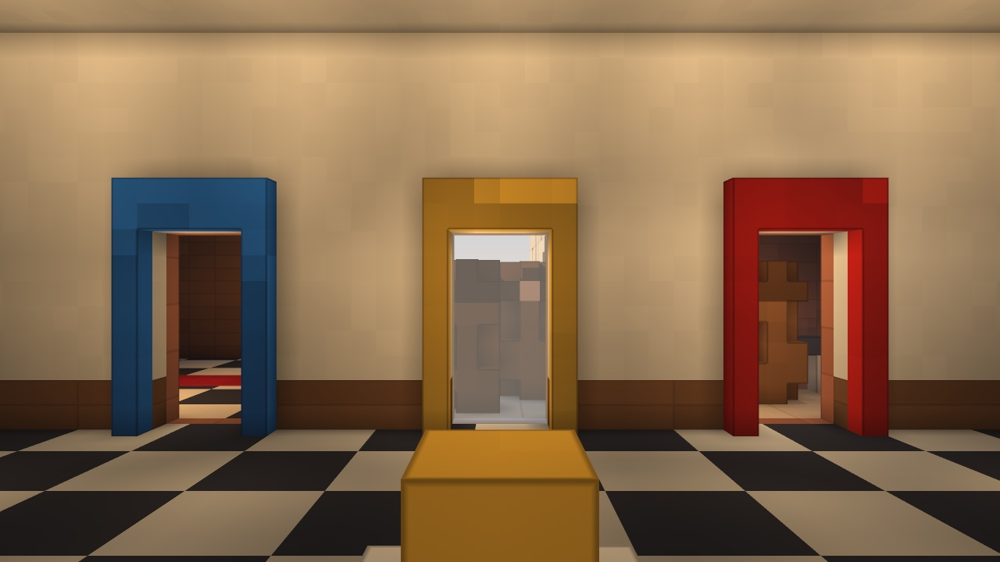
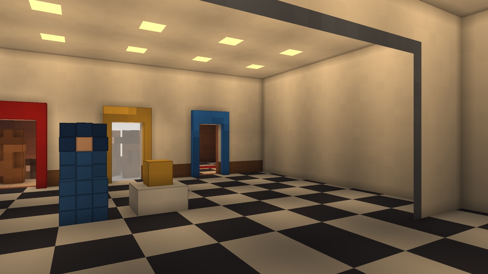
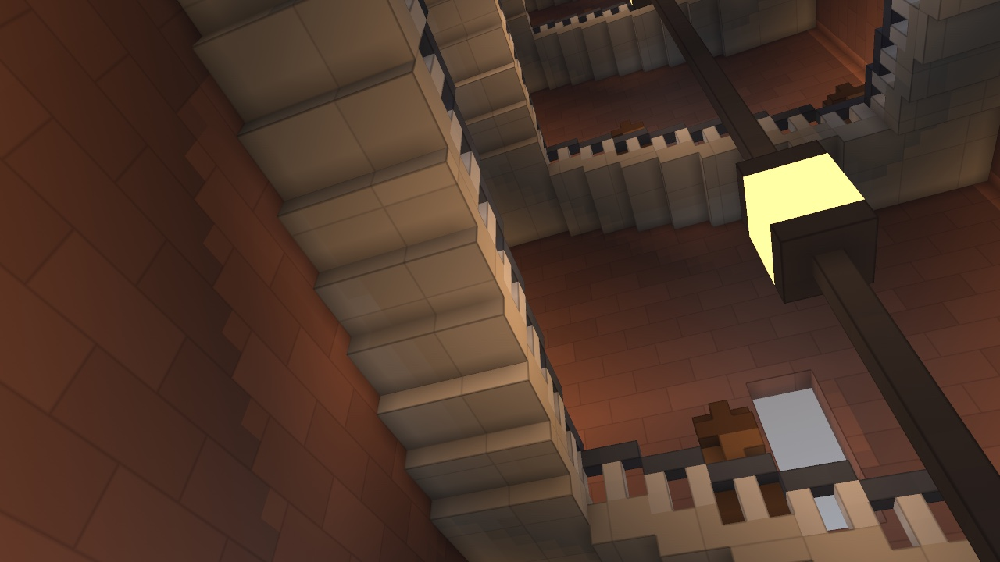
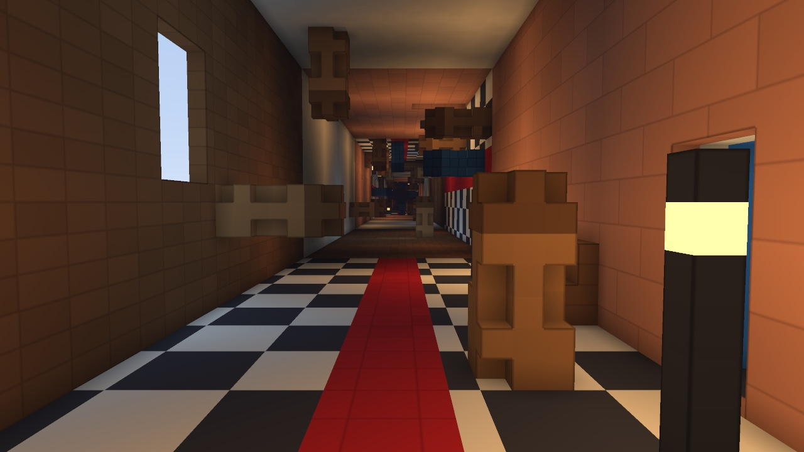

# Groxel: voxel worlds with glued faces

Paper, reference engine and full reproduction package for **Groxel**, a voxel engine in which a
rectangle of voxel faces can be glued to another by any of the 48 symmetries of the cube.

Paper: [`paper/groxel.pdf`](paper/groxel.pdf), "Groxel: voxel worlds with glued faces, traversed
by permuting the stepping state" (Keston Aquino-Michaels, No Way Labs, 2026).



## What it is

In an ordinary voxel world the cell east of `(x, y, z)` is `(x + 1, y, z)`. Here that is only
the default. A *seam* makes a rectangle of voxel faces lead somewhere else: to another room, or
back into the same one, turned any of the 48 ways a cube can be turned. Rays, light, shadows,
walking bodies and sprites all move through the world one face at a time, so all of them follow
seams without knowing that seams exist.

Voxel worlds with turned gluings are older than this engine: boxspace, HyperRogue and fishpye
each have a form of them, and the paper's related-work section says what each does. What is
here is narrower. A ray crosses a seam by permuting its Amanatides-Woo stepping state, with
nothing recalculated, so a trace through any number of seams is the same floating-point
computation as the trace of that ray in the unrolled world. Light, sprites and bodies cross by
the same adjacency. One test, which cuts a world, turns a piece of it and glues it back,
specifies all of them.

## Results in the paper

The test space is a cube of 8 voxels a side glued to itself on every face, one pair of faces
with a quarter turn. The "uncut trace" is the same ray traced in the unrolled space. The
earlier methods are re-implementations written from the sources of boxspace, fishpye, noeuclid
and HyperRogue.

| Measurement | This engine | Earlier methods |
|---|---|---|
| Rays, of 20,000, that equal the uncut trace bit for bit after 1,000 crossings | 20,000 | 197, 792 and 8,980 |
| The same over 11 crossing counts from 0 to 1,000 | 220,000 of 220,000 | |
| Median distance error after 1,000 crossings (5,396 voxels), in voxels | 1.7e-4 | 2.4e-4 to 2.9e-2 |
| The same with the usual running total in place of counted steps | 8.7e-2 | |
| Pixels, of 1,843,200 in 8 pictures, that differ from the uncut picture | 0 | 6 to 23; 254 and 2,279 with a nudged position |
| Extra cost of a crossing over a plain step | 25 ns | 41 to 43 ns |
| Cost of testing a face for a seam, in a world with none | 0.16 ns of a 4.83 ns step | |

Agreement with the uncut trace is a different property from accuracy, and the paper reports
both. The usual Amanatides-Woo stepping keeps a running total that drifts on long rays, with or
without seams. The cursor counts its steps instead.

## The four worlds

**The Gallery.** An ordinary room with three doors and a mirror. Each door is glued to a door in
another world, and you can see through it before you walk through it. The mirror is a seam from
each face of the glass to itself, reflected, and it shows the room and you in it.



**The Well.** A square stairwell 32 voxels tall whose top face is glued to its bottom face. Walk
down one lap and you are on the landing you left.



**The Tower.** A walkway round the outside of a tower. It descends on all four sides, and it
closes. East of the tower, space is cut along a half-plane and glued back 60 voxels out of step:
a left-handed screw dislocation, which a test measures by walking a Burgers circuit round it.


**The Hall.** A square corridor whose far end is glued to its near end a quarter turn round. The
carpet you are walking on is on the wall ahead of you, then the ceiling. So are the other
walkers, and so are you.



## Run it

Needs Rust 1.85 or later.

```
cargo test --workspace
cargo run --release -p groxel-walk
cargo run --release -p groxel-app --bin still -- overlook tower.png t=4 dy=-20
```

The walker opens a window on the Gallery.

| Key | Does |
|---|---|
| click | capture the mouse; then left click places a glowing marker and right click removes a voxel |
| W A S D, mouse | move, look |
| space, shift | jump, run |
| F | fly on or off; Q and E go down and up while flying |
| 1 to 9, tab | go to a world, or to the next one |
| P | save a screenshot |
| esc | release the mouse; again to quit |

`still` renders one picture without a window, from a named place (`gallery`, `well`, `tower`,
`overlook`, `hall`) with arguments such as `w=1280 h=720 t=3 yaw=150`.

The renderer traces every pixel on the CPU with no acceleration structure. A frame of 640 by 360
takes 27 to 80 ms on the eight cores of an Apple M3.

## Use

The crates are not on crates.io. To use one, depend on this repository:

```toml
[dependencies]
groxel = { git = "https://github.com/no-way-labs/groxel" }
```

```rust
use groxel::{ivec3, vec3, HitKind, Ray, TraceOpts, World, trace};

let mut world = World::new();

// A corridor with a floor. Its far end opens onto its near end.
let corridor = world.add_room("corridor", ivec3(32, 12, 8));
world.room_mut(corridor).fill(ivec3(0, 0, 0), ivec3(31, 0, 7), 1);
world.wrap(corridor, 0)?;

// A ray fired down it comes round and hits the post behind you.
world.room_mut(corridor).fill(ivec3(2, 1, 4), ivec3(2, 8, 4), 2);
let ray = Ray::new(corridor, vec3(10.5, 3.5, 4.5), vec3(1.0, 0.0, 0.0));
let hit = trace(&world, ray, &TraceOpts::default());

assert_eq!(hit.kind, HitKind::Solid);
assert_eq!(hit.material, 2);
assert_eq!(hit.crossings, 1);
assert!((hit.t - 23.5).abs() < 1e-4);
```

This example is the core crate's documentation example, which `cargo test` compiles and runs.

The core's main types:

| Type | What it is |
|---|---|
| `Orientation` | One of the 48 ways a cube maps onto a cube. An index into tables built at compile time |
| `LatticeMap` | A turn and a shift of the voxel lattice. Composes and inverts in integer arithmetic |
| `Seam` | A rectangle of voxel faces that all lead somewhere else, by one `LatticeMap` |
| `World`, `Room` | Rooms of voxels, and `glue`, `wrap`, `mirror` and `link` to join them |
| `Cursor` | A point moving along a line, one face at a time, through seams. The only traversal loop |
| `trace`, `visit` | First solid voxel along a ray; or a callback for every voxel on the way |
| `Pose` | A voxel, a point in it and an orientation: where a thing is. `advance` moves it through seams |
| `Overlay`, `Sprite` | A frame's moving voxels, placed by walking the lattice, so a figure in a doorway is in both rooms |

## How it works

A seam's map is a signed permutation of the axes and an integer shift. The tracer keeps the
usual per-axis stepping state: which way the ray steps, the distance to the first face, the
distance between faces, and the number of faces crossed. When a ray crosses a seam, each axis's
values move to the axis the seam's turn sends it to, the step direction takes the turn's sign,
and no floating-point value is recalculated.

Two details make the result equal to the uncut trace and not merely close to it. When a ray
passes through a voxel edge, two faces are equally near, and the choice between them decides
which voxel is visited. A seam renumbers the axes, so the cursor breaks such ties in the axis
order of the frame the ray started in, which it carries along. And the distance to the next
face is `first + count * delta`, which rounds the same way however many seams have been
crossed.

[`docs/exactness.md`](docs/exactness.md) states the claim exactly and gives the argument for it
against the code, with what the claim does not cover.

## What the tests establish

The specification is one property, applied to everything that moves. Cut a random world in two,
turn one half each of the 48 ways a cube can be turned, and glue it back. Nothing may be able to
tell.

- **Rays.** 400 rays per orientation report the same hit, material, voxel and face as in the
  uncut world, and a distance and step count that are bit-identical to it. The same holds for
  rays through voxel edges and corners.
- **Every step.** A cube is cut into 125 blocks, each turned at random, and two cursors are
  compared after every face they cross: distance, voxel, entry face and material, through a
  dozen seams a ray.
- **Many crossings.** In a space glued to itself on every side, a ray that has crossed hundreds
  of seams still equals the uncut trace bit for bit.
- **Poses.** A point walked back and forth across the seam, 60 moves per orientation, has the
  voxel, position (to 0.002) and frame it has in the uncut world after every move.
- **Light.** Every voxel has the lamp light and sky light it has in the uncut world.
- **Sprites.** A sprite placed across the cut occupies the same voxels, and rays see it the same,
  including rays that look past one sprite as its viewer would.
- **Bodies.** A body that walks across, climbs a step and goes round a post ends where it ends in
  the uncut world, standing on the floor of the turned half with its head where that half's
  "up" now is.
- **Pictures.** A frame rendered from the same place is the same frame: over 48 orientations no
  pixel differs by one grey level.

Each of these tests was checked to fail when the thing it guards is broken: light that ignores
seams, a sprite or a body that is not turned, a tie broken by the current axis number.

## Reproducing the paper

```
sh reproduce.sh
```

regenerates every number, table and figure of the paper and then builds the PDF. It needs
`cargo` and `python3`; the stills are converted with `sips`, which is part of macOS, and the
paper is built if `latexmk` is installed. It takes under ten minutes on an Apple M3 and records
the machine, compiler, flags, seeds and commit in `experiments/results/environment.txt`.

The agreement, accuracy and picture results are deterministic and come out byte for byte the
same on each run. The timings vary by a few percent between runs.
[`experiments/README.md`](experiments/README.md) describes each measurement, the baselines and
what was not measured.

## What is in this repository

| Path | Contents |
|---|---|
| `crates/groxel` | The core: orientations, rooms, seams, the tracer, poses, and the overlay that holds a frame's moving voxels. No dependencies |
| `crates/groxel-light` | Lamp and sky light, flooded through seams |
| `crates/groxel-render` | A CPU ray tracer: shading, shadows, ambient occlusion, outlines, PNG output |
| `crates/groxel-body` | A walking body with gravity and stairs, whose "up" turns with the seams it crosses |
| `crates/groxel-app` | The four worlds, their figures, and `still`, which takes pictures of them |
| `crates/groxel-walk` | A window to walk around them in. The only crate with dependencies outside the workspace |
| `experiments/` | The measurement programs, the baselines, their results, and the script that draws the figures |
| `paper/` | The PDF, its LaTeX source, and the generated tables, figures and plot data |
| `docs/` | The argument for the agreement claim, and the pictures on this page |

No crate uses `unsafe`.

## Contact

Questions and corrections are welcome, by email to kestonamichaels at gmail.com or as an issue on
this repository.

## Citation

```bibtex
@misc{aquinomichaels2026groxel,
  title  = {Groxel: voxel worlds with glued faces, traversed by permuting the stepping state},
  author = {Aquino-Michaels, Keston},
  year   = {2026},
  note   = {No Way Labs},
  url    = {https://github.com/no-way-labs/groxel}
}
```

## Licence

The code (the crates in `crates/`, the programs and scripts in `experiments/`, `paper/stills.sh`
and `reproduce.sh`) is released under the MIT licence ([`LICENSE`](LICENSE)). The paper, its
figures and tables in `paper/`, the pictures and documents in `docs/`, and the results in
`experiments/results/` are released under CC BY 4.0 ([`LICENSE-paper`](LICENSE-paper)).
