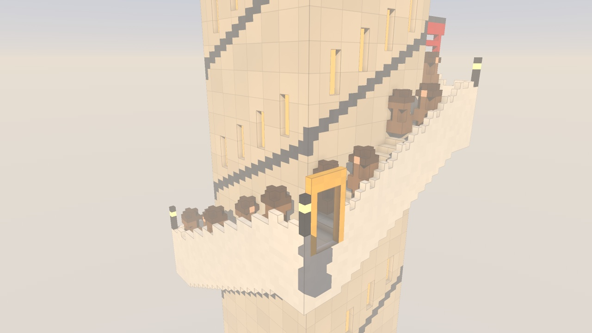

# Groxel: voxel worlds with glued faces

Paper, reference engine and full reproduction package for **Groxel**, a voxel engine in which a
rectangle of voxel faces can be glued to another by any of the 48 symmetries of the cube.

Paper: [`paper/groxel.pdf`](paper/groxel.pdf), "Groxel: voxel worlds with glued faces, traversed
by permuting the stepping state" (Keston Aquino-Michaels, No Way Labs, 2026).


## What it is

In an ordinary voxel world the cell east of `(x, y, z)` is `(x + 1, y, z)`. In a Groxel world a
*seam* can make a rectangle of voxel faces lead somewhere else: to another room, or back into
the same room, turned by any of the 48 symmetries of the cube. Rays, light, sprites and walking
bodies all move by crossing faces through one adjacency function, and they therefore follow
seams with no code of their own for them.

boxspace, HyperRogue and fishpye already glue cubes or voxel grids with turns, and the paper's
related-work section describes each. Those systems carry a ray across a gluing by transforming
the ray and recomputing its traversal state, or they keep no traversal state. Groxel permutes
the ray's Amanatides-Woo stepping state and recalculates nothing. A trace through any number of
seams is then the same floating-point computation as the trace of that ray in the unrolled
world, and the two can be compared bit for bit. The engine is specified by one test built on
that comparison: cut a world, turn one piece by each of the 48 symmetries, glue it back, and
require that rays, light, sprites, bodies and rendered frames do not change.

## Results in the paper

The test space is a cube of 8 voxels a side glued to itself on every face, one pair of faces
with a quarter turn. The uncut trace of a ray is the same ray traced in the unrolled space. The
earlier methods are our re-implementations of the crossing rules of boxspace, fishpye, noeuclid
and HyperRogue, written from their sources.

| Measurement | This engine | Earlier methods |
|---|---|---|
| Rays, of 20,000, that equal the uncut trace bit for bit after 1,000 crossings | 20,000 | 197, 792 and 8,980 |
| The same over 11 crossing counts from 0 to 1,000 | 220,000 of 220,000 | |
| Median distance error after 1,000 crossings (5,396 voxels), in voxels | 1.7e-4 | 2.4e-4 to 2.9e-2 |
| The same with the usual running total in place of counted steps | 8.7e-2 | |
| Pixels, of 1,843,200 in 8 pictures, that differ from the uncut picture | 0 | 6 to 23; 254 and 2,279 with a nudged position |
| Extra cost of a crossing over a plain step | 25 ns | 41 to 43 ns |
| Cost of testing a face for a seam, in a world with none | 0.16 ns of a 4.83 ns step | |

Agreement with the uncut trace does not bound the error of either trace. The usual running
total `tMax += tDelta` drifts on long rays with or without seams, and the cursor therefore
counts its steps, which reduces the median error at 5,396 voxels from 8.7e-2 to 1.7e-4 voxels.

## The four worlds

**The Gallery.** An ordinary room with three doors and a mirror. Each door is glued to a door in
another world, and that world is visible through the door before you walk through it. The mirror
is a seam from each face of the glass to itself with a reflection, and it shows the room and
your own figure.


**The Well.** A square stairwell 32 voxels tall whose top face is glued to its bottom face. One
lap down the stairs returns you to the landing you left.


**The Tower.** A walkway round the outside of a tower, which descends on all four sides and
closes. East of the tower, space is cut along a half-plane and glued back 60 voxels out of step,
which makes the edge of the cut a left-handed screw dislocation. A test measures it by walking a
Burgers circuit round that edge.



**The Hall.** A square corridor whose far end is glued to its near end with a quarter turn. The
carpet under your feet continues onto the wall ahead and then onto the ceiling, and the other
walkers and your own figure appear there with it.


## Run it

Groxel needs Rust 1.85 or later.

```
cargo test --workspace
cargo run --release -p groxel-walk
cargo run --release -p groxel-app --bin still -- overlook tower.png t=4 dy=-20
```

The walker opens a window on the Gallery and takes these keys.

| Key | Does |
|---|---|
| click | capture the mouse; then left click places a glowing marker and right click removes a voxel |
| W A S D, mouse | move, look |
| space, shift | jump, run |
| F | fly on or off; Q and E go down and up while flying |
| 1 to 9, tab | go to a world, or to the next one |
| P | save a screenshot |
| esc | release the mouse; again to quit |

`still` renders one picture without a window, from a named place (`gallery`, `well`, `tower`,
`overlook`, `hall`) with arguments such as `w=1280 h=720 t=3 yaw=150`.

The renderer traces every pixel on the CPU with no acceleration structure, and a frame of 640
by 360 pixels takes 27 to 80 ms on the eight cores of an Apple M3.

## Use

The crates are not on crates.io, and a project that uses one depends on this repository:

```toml
[dependencies]
groxel = { git = "https://github.com/no-way-labs/groxel" }
```

```rust
use groxel::{ivec3, vec3, HitKind, Ray, TraceOpts, World, trace};

let mut world = World::new();

// A corridor with a floor. Its far end opens onto its near end.
let corridor = world.add_room("corridor", ivec3(32, 12, 8));
world.room_mut(corridor).fill(ivec3(0, 0, 0), ivec3(31, 0, 7), 1);
world.wrap(corridor, 0)?;

// A ray fired down it comes round and hits the post behind you.
world.room_mut(corridor).fill(ivec3(2, 1, 4), ivec3(2, 8, 4), 2);
let ray = Ray::new(corridor, vec3(10.5, 3.5, 4.5), vec3(1.0, 0.0, 0.0));
let hit = trace(&world, ray, &TraceOpts::default());

assert_eq!(hit.kind, HitKind::Solid);
assert_eq!(hit.material, 2);
assert_eq!(hit.crossings, 1);
assert!((hit.t - 23.5).abs() < 1e-4);
```

`cargo test` compiles and runs this example as the documentation example of the core crate.

The core's main types:

| Type | What it is |
|---|---|
| `Orientation` | One of the 48 ways a cube maps onto a cube. An index into tables built at compile time |
| `LatticeMap` | A turn and a shift of the voxel lattice. Composes and inverts in integer arithmetic |
| `Seam` | A rectangle of voxel faces that all lead somewhere else, by one `LatticeMap` |
| `World`, `Room` | Rooms of voxels, and `glue`, `wrap`, `mirror` and `link` to join them |
| `Cursor` | A point moving along a line, one face at a time, through seams. The only traversal loop |
| `trace`, `visit` | First solid voxel along a ray; or a callback for every voxel on the way |
| `Pose` | A voxel, a point in it and an orientation: where a thing is. `advance` moves it through seams |
| `Overlay`, `Sprite` | A frame's moving voxels, placed by walking the lattice; a figure in a doorway is in both rooms |

## How it works

A seam's map is a signed permutation of the axes with an integer shift. The tracer holds the
usual stepping state for each axis: the direction of the step, the distance to the first face,
the distance between faces and the number of faces crossed. When a ray crosses a seam, each
axis's values move to the axis that the seam's turn sends that axis to, the step direction is
multiplied by the turn's sign, and no floating-point value is recalculated.

A ray through a voxel edge reaches two faces at the same distance, and the order in which it
crosses them decides which voxel it visits. Because a seam renumbers the axes, the cursor breaks
such ties in the axis order of the frame the ray started in, and it carries that order through
every seam. The cursor also computes the distance to the next face as `first + count * delta`,
which rounds identically in the glued world and in the unrolled one and does not accumulate
error along the ray.

[`docs/exactness.md`](docs/exactness.md) states the claim in full, argues it against the code,
and lists what the claim does not cover.

## What the tests establish

The engine is specified by one property: cut a random world in two, turn one half by each of
the 48 symmetries of the cube, glue it back, and no observable may differ between the cut world
and the whole one. The tests apply the property to each kind of thing that moves.

- **Rays.** 400 rays per orientation report the same hit, material, voxel and face as in the
  whole world, and a distance and step count that are bit-identical to it. The same holds for
  rays through voxel edges and corners.
- **Every step.** A cube is cut into 125 blocks, each turned at random, and two cursors are
  compared after every face they cross: distance, voxel, entry face and material, through up to
  a dozen seams on a ray.
- **Many crossings.** In a space glued to itself on every side, a ray that has crossed 300
  seams equals the uncut trace bit for bit.
- **Poses.** A point walked back and forth across the seam, 60 moves per orientation, has the
  voxel, position (to 0.002) and frame it has in the whole world after every move.
- **Light.** Every voxel has the lamp light and sky light it has in the whole world.
- **Sprites.** A sprite placed across the cut occupies the same voxels, and rays see it the same,
  including rays that look past one sprite as its viewer would.
- **Bodies.** A body that walks across, climbs a step and goes round a post ends where it ends in
  the whole world, standing on the floor of the turned half with its head where that half's
  "up" now is.
- **Pictures.** A frame rendered from the same place is the same frame: over 48 orientations no
  pixel differs by one grey level.

Each of these tests was checked to fail when the thing it guards is broken: light that ignores
seams, a sprite or a body that is not turned, a tie broken by the current axis number.

## Reproducing the paper

`sh reproduce.sh` regenerates every number, table and figure of the paper and then builds the
PDF. It needs `cargo` and `python3`, it converts the stills with `sips`, which is part of macOS,
and it builds the paper if `latexmk` is installed. A run takes under ten minutes on an Apple M3
and records the machine, compiler, flags, seeds and commit in
`experiments/results/environment.txt`.

The agreement, accuracy and picture results are deterministic and are byte for byte the same on
each run, and the timings vary by a few percent.
[`experiments/README.md`](experiments/README.md) describes each measurement and each baseline.

## What is in this repository

The repository is a Cargo workspace, and none of its crates uses `unsafe`.

| Path | Contents |
|---|---|
| `crates/groxel` | The core: orientations, rooms, seams, the tracer, poses, and the overlay that holds a frame's moving voxels. No dependencies |
| `crates/groxel-light` | Lamp and sky light, flooded through seams |
| `crates/groxel-render` | A CPU ray tracer: shading, shadows, ambient occlusion, outlines, PNG output |
| `crates/groxel-body` | A walking body with gravity and stairs, whose "up" turns with the seams it crosses |
| `crates/groxel-app` | The four worlds, their figures, and `still`, which takes pictures of them |
| `crates/groxel-walk` | A window to walk around them in. The only crate with dependencies outside the workspace |
| `experiments/` | The measurement programs, the baselines, their results, and the script that draws the figures |
| `paper/` | The PDF, its LaTeX source, and the generated tables, figures and plot data |
| `docs/` | The argument for the agreement claim, and the pictures on this page |

## Contact

Questions and corrections are welcome, by email to kestonamichaels at gmail.com or as an issue on
this repository.

## Citation

```bibtex
@misc{aquinomichaels2026groxel,
  title  = {Groxel: voxel worlds with glued faces, traversed by permuting the stepping state},
  author = {Aquino-Michaels, Keston},
  year   = {2026},
  note   = {No Way Labs},
  url    = {https://github.com/no-way-labs/groxel}
}
```

## Licence

The code (the crates in `crates/`, the programs and scripts in `experiments/`, `paper/stills.sh`
and `reproduce.sh`) is released under the MIT licence ([`LICENSE`](LICENSE)). The paper, its
figures and tables in `paper/`, the pictures and documents in `docs/`, and the results in
`experiments/results/` are released under CC BY 4.0 ([`LICENSE-paper`](LICENSE-paper)).
