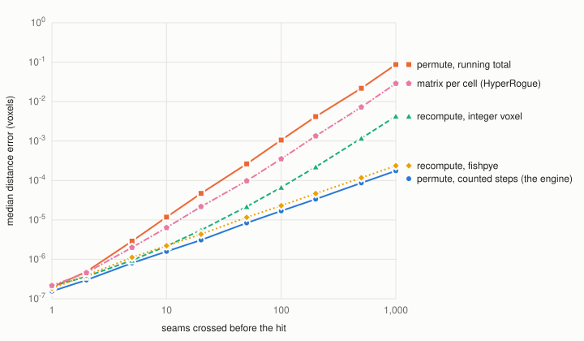

# Experiments

The measurements behind the paper's numbers: what was run, against what, and what came out.

```
sh experiments/run.sh
```

runs every measurement here. It writes the CSVs and the error figure to `results/`, the tables
of this file, and the table bodies and plot data the paper reads. It records the machine,
compiler, flags, seeds and commit in `results/environment.txt`. `sh reproduce.sh` at the top of
the repository runs it, then the stills and frame times of the four worlds, then builds the
paper. Or one program at a time:

```
cargo run --release -p groxel-experiments --bin crossing_error -- experiments/results/crossing_error.csv
cargo run --release -p groxel-experiments --bin step_cost      -- experiments/results/step_cost.csv
cargo run --release -p groxel-experiments --bin frames         -- experiments/results/frames.csv
cargo run --release -p groxel-experiments --bin sizes
python3 experiments/figures.py
cargo test -p groxel-experiments
```

The results here are from an Apple M3 with 24 GB, macOS 15.8.2 and rustc 1.99.0, in the release
profile on one thread. Each program holds the seeds it was designed on as constants, and takes
others on its command line. `crossing_error` and `frames` are deterministic. `step_cost` reports
times, and its crossing costs moved by up to 5 ns between runs.

The tables below are written by `figures.py` from the run on the design seeds. The paper's
tables come from a second run on other seeds (`*_confirm.csv`), so that no number in the paper
is from the seeds the experiments were designed on.

## The world

A cube of 8 voxels a side with every face glued to the opposite one: x and y by plain wraps, z
with a quarter turn. That is the quarter-turn space with a voxel lattice in it. A ray in it never
leaves, so a measurement can choose how many seams it crosses. 15% of the voxels are solid.

Each ray passes through its first `c` seams unobstructed and then stops at the first solid
voxel. The same ray is traced in the unrolled world (all of space tiled with turned copies of
the cube), which has no seams. A voxel of the unrolled world is looked up by folding its integer
coordinates back into the cube. A test checks the folding against the engine's lattice walk.

## What is compared

| Name | What it does at a seam | After |
|---|---|---|
| `engine` | The engine's cursor. The stepping state moves to the axes the seam's turn sends it to, and nothing is recalculated. The distance to the next face is `first + count * delta` (counted steps) | this engine |
| `perm-count` | The same, written in this crate against the public API | |
| `perm-run` | The same rule with the usual running total, `tMax += tDelta` | |
| `recompute` | The crossing point and direction are transformed, the voxel goes through the seam's integer map, the distance restarts, and step, tMax and tDelta are worked out again | boxspace, which carries an integer cube index and recomputes the exit face in every cube |
| `fishpye` | The origin and direction are transformed, one running distance is kept, the voxel is the truncated point at that distance, and step, tDelta and tMax are reset | fishpye, `raytrace.cl` lines 313 to 343 at commit `8e9cbef` |
| `floor-ε` | As `recompute`, but the point is first moved ε along the ray and the voxel is the floor of the transformed point | the rule of noeuclid, `Shaders/Pass1.frag` at commit `b2ab611`, where ε is 0.01 |
| `cell-matrix` | Nothing special, because every wall of every cell is crossed the same way. The ray is a position and a tangent in the coordinates of its cell. The distance to each of the six walls is found afresh, the position moves to the nearest, and a matrix takes position and tangent into the next cell's coordinates. Distance is a sum of the wall-to-wall distances | HyperRogue, the Euclidean branch of the shader built in `raycaster.cpp`, read at commit `54a3125` |

The baselines are re-implementations in this world, not the original programs.

- fishpye's portals are blocks with volume and any 4x4 matrix. Here a seam is a face and the map
  is a signed permutation with an integer shift. When its truncated point falls outside the room
  it is pulled back in, which repairs a point that fell just short of the face. In fishpye's own
  grid that point is a real voxel, one behind the right one.
- noeuclid is not a DDA. It moves a point 0.01 past each boundary and takes the floor, at every
  step. `floor-ε` applies that rule at seams only, and therefore understates what noeuclid loses.
- HyperRogue's shader declares its numbers `mediump`. Desktop OpenGL gives that 32 bits, and
  `cell-matrix` runs in 32 bits. A device that gives `mediump` 16 bits would do worse and is not
  measured. The shader's expressions are kept in its order; its matrices here have entries 0, 1
  and -1. The shader uses its distance only for fog.

Two references:

- **Uncut.** The unrolled world in single precision, with the same form of stepping state.
  This is what an engine with no seams computes.
- **True.** The unrolled world in double precision. Its rounding is far below anything measured
  here, and it stands for the true ray.

## Result 1: a permuting trace is the uncut trace

Rays whose result equals the uncut trace bit for bit (voxel, face, material, distance, number
of voxels visited), out of 20,000 at each crossing count. Each permuting method is compared with
the uncut trace in its own form of stepping state, and the baselines with the engine's.

<!-- agreement: written by figures.py -->
| Seams crossed | 1 | 10 | 100 | 1,000 |
|---|---|---|---|---|
| `engine` | 20,000 | 20,000 | 20,000 | 20,000 |
| `perm-count` | 20,000 | 20,000 | 20,000 | 20,000 |
| `perm-run` | 20,000 | 20,000 | 20,000 | 20,000 |
| `recompute` | 12,053 | 8,956 | 3,662 | 786 |
| `fishpye` | 14,026 | 9,919 | 10,199 | 8,897 |
| `cell-matrix` | 9,426 | 3,457 | 796 | 171 |
| `floor-1e-3` | 10,370 | 8,563 | 3,453 | 346 |
<!-- end agreement -->

The three permuting methods are identical to their uncut traces on all 220,000 rays of the full
table (11 crossing counts). This is the cut, turn and re-glue test extended from one crossing to
a thousand, and a test in this crate keeps it true.

`cell-matrix` is not a DDA, so its distances differ from the uncut trace's in the last bits
with or without seams: it equals the uncut trace on 9,047 of 20,000 rays that cross no seam.

## Result 2: accuracy on long rays

Against the true ray. "Off" is the number of rays, out of 20,000, that end on a different voxel
or face from the true ray. "Error" is the median distance error in voxels of the rays that end
on the true surface.

<!-- accuracy: written by figures.py -->
| Seams crossed (mean distance) | 1 (7) | 10 (55) | 100 (540) | 1,000 (5,398) |
|---|---|---|---|---|
| `engine`: off | 0 | 0 | 0 | 6 |
| `engine`: error | 1.6e-7 | 1.6e-6 | 1.7e-5 | 1.8e-4 |
| `perm-run`: off | 0 | 0 | 44 | 2,883 |
| `perm-run`: error | 2.0e-7 | 1.2e-5 | 1.1e-3 | 8.7e-2 |
| `recompute`: off | 0 | 0 | 0 | 0 |
| `recompute`: error | 2.1e-7 | 2.2e-6 | 6.7e-5 | 4.3e-3 |
| `fishpye`: off | 0 | 0 | 0 | 11 |
| `fishpye`: error | 1.8e-7 | 2.2e-6 | 2.3e-5 | 2.4e-4 |
| `cell-matrix`: off | 0 | 0 | 0 | 5 |
| `cell-matrix`: error | 2.2e-7 | 6.4e-6 | 3.5e-4 | 2.9e-2 |
| `floor-1e-3`: off | 7 | 3 | 7 | 8 |
| `floor-1e-2`: off | 68 | 67 | 66 | 84 |
<!-- end accuracy -->



With a running total the error grows with the square of the distance. The cause is the addition
`tMax += tDelta`, whose rounding has a constant bias while tMax stays in one binade. It has
nothing to do with seams: the uncut trace with a running total has the same error, bit for bit.
At 1,000 crossings (5,400 voxels) the median error is 0.087 voxels and 14% of rays end on
another surface.

Every recomputing method works its distances out again at each seam, and loses the drift that
way. A permuting trace with a running total is therefore less accurate than any of them on long
rays, although a crossing adds no rounding to it.

Counted steps remove the drift without recomputing. The engine's distance is as accurate as the
best baseline's at every crossing count (1.8e-4 against `fishpye`'s 2.4e-4 at 1,000 crossings),
and the engine equals its uncut trace bit for bit. This result is why the engine's cursor counts
its steps.

`cell-matrix` finds the surface as reliably as any method here: no ray in 20,000 is off up to
100 crossings, and 5 are off at 1,000. Its position is never more than a voxel from the origin
of its coordinates, so the position keeps its precision however far the ray has gone. Its
distance is another matter. It is a sum of the wall-to-wall distances, and it drifts as the
running total does: 2.9e-2 voxels at 1,000 crossings, a third of `perm-run`'s error and 160
times the engine's. HyperRogue uses that distance for fog only.
The method pays for its position with six wall distances in every cell.

The `floor` variants put a ray in the wrong voxel when it crosses a seam close to a voxel edge.
The rate does not depend on the number of crossings here, because only a ray's last few
crossings come after the gate: 0.03% of rays with a nudge of 0.001 and 0.35% with 0.01.

## Result 3: cost

Time per step in empty quarter-turn spaces of side 4 to 64, fitted as
`plain step + crossing rate × extra`:

<!-- cost: written by figures.py -->
| | Plain step (ns) | Extra per crossing (ns) |
|---|---|---|
| `engine` | 7.3 | 25 |
| `perm-count` | 7.5 | 26 |
| `perm-run` | 6.7 | 24 |
| `recompute` | 6.9 | 42 |
| `fishpye` | 6.8 | 43 |
| `floor-1e-2` | 6.8 | 41 |
<!-- end cost -->

Recomputation costs 16 to 18 ns more per crossing than permutation in this run (three divisions
and the transform of a point), and 17 to 19 in another. More than half of a
recomputing crossing's cost is common to every method: finding the seam and mapping the voxel.
Counted steps cost 0.7 ns more per plain step than a running total, measured on the two loops
in this crate (7.5 against 6.7).

`cell-matrix` is not timed. It is a method for a GPU shader, and a loop of it on a CPU would
time this crate's transcription of it.

## Result 4: the link test

A room of side 128 with no seams, and 40,000 rays from its middle: 4.7 million steps. The
cursor's loop is copied into `step_cost` over a bare array of the engine's 16-bit cells, and
timed with the test of a face's link bit compiled in and with it left out. Nothing else differs
between the two. The loops take turns, 31 repeats each.

<!-- link test: written by figures.py -->
| | Fastest (ns a step) | Median (ns a step) |
|---|---|---|
| The cursor's loop, copied, without the link test | 4.67 | 4.69 |
| The same loop with the link test | 4.83 | 4.84 |
| The engine's cursor | 7.59 | 7.64 |
<!-- end link test -->

The link test costs 0.16 ns of a 4.8 ns step by the fastest repeats and 0.15 by the medians,
which is 3%. Five other runs of the program gave 0.08 to 0.16.

The engine's cursor takes 7.6 ns for the same step, 2.8 ns more than the copied loop with the
test in it. That difference is not the link test. The cursor looks its room up by id on every
step, returns a value that names the face and the seam, checks for an overlay when it reads a
material, refuses a face at infinite distance, and is called across a crate boundary. What each
of these costs is not separated.

The comparison is between two copies of one loop because the form of a loop moves its time more
than the test does: hand-written loops of other forms came out slower than the cursor.

## Result 5: memory

| | Bytes |
|---|---|
| A voxel in the core | 2 (material, link bits) |
| A voxel's light | 2 (lamp, sky) |
| A voxel in an overlay | 1 bit, and a hash-map entry if something is stamped there |
| A seam | 56, and 4 for its entry in its room's list |
| A cursor | 136 |

A seam's cost does not depend on its size. A table with one entry per linked face would hold
31,280 entries for the Tower's cut; here that cut is two seam records.

## Result 6: pictures

`frames` draws 8 views of 640 by 360 in the quarter-turn space with 2% of its voxels solid, one
ray a pixel, from random places and in random directions. A view is the same ten voxels repeated
into the distance through the seams: a ray crosses 8.4 seams on average and at most 501. A
pixel's colour comes from the material and the face the ray stopped on, faded with distance and
rounded to 8 bits a channel. Each method's pictures are compared with the pictures its uncut
trace draws, pixel by pixel, 1,843,200 pixels in all.

<!-- pixels: written by figures.py -->
| | Pixels that differ | On another surface | Most in one view |
|---|---|---|---|
| `engine` | 0 | 0 | 0 |
| `perm-run` | 0 | 0 | 0 |
| `recompute` | 16 | 8 | 4 |
| `fishpye` | 14 | 10 | 5 |
| `cell-matrix` | 18 | 9 | 6 |
| `floor-1e-3` | 164 | 160 | 32 |
| `floor-1e-2` | 1,511 | 1,489 | 313 |
<!-- end pixels -->

"On another surface" counts the differing pixels whose ray stopped on another voxel or face.
The rest stopped on the same surface at a distance different enough to move the fade by one
level of 255.

The engine's pictures are the uncut pictures. `recompute`, `fishpye` and `cell-matrix` each
differ in 14 to 18 pixels, about one in 100,000, although 45 to 71% of their rays differ from
the uncut trace in some bit. The `floor` variants differ in 164 and 1,511 pixels, up to 313 in
one view, 1,649 of the 1,675 on another surface: single pixels along voxel edges. The run on
other seeds gave 0, 6 to 23, and 254 and 2,279.

The shading here reads no hit point, so it has no textures and no shadow rays. A wrong voxel
would show in those as it shows here.

## Not measured

- **Where the engine cursor's other 2.8 ns go.** Result 4 prices the link test and finds the
  cursor slower than a copy of its own loop for other reasons, which are listed there and not
  measured one by one.
- **The baselines in the engine's renderer.** Result 6 uses a flat shading written in this
  crate. The engine's own frames match the uncut world's with light, shadows, outlines and
  figures (no pixel of 248,832 differs, `groxel-render/tests/render.rs`), and the baselines
  have not been put through that renderer.
- **The original programs.** fishpye, noeuclid and HyperRogue were read, not run. HyperRogue's
  rule is measured in 32 bits, and not in the 16 bits that `mediump` allows.
- **Other machines.** One CPU, one compiler.

## Summary

- The engine agrees with the uncut trace bit for bit over a thousand crossings. No baseline
  does: the best, `fishpye`, agrees on 8,897 of 20,000 rays at 1,000 crossings.
- Agreement is a different property from accuracy, and a permuting trace needs counted steps to
  have both. With a running total it agrees with its uncut trace and is the least accurate
  method measured.
- With counted steps the engine's distance is as accurate as the best baseline's, and a crossing
  is 16 to 19 ns cheaper than a recomputing one.
- A matrix at every cell wall, HyperRogue's rule, finds the right voxel as reliably as anything
  here, and loses its distance. The engine has both for the cost of a link bit: 0.1 to 0.2 ns a
  step.
- In a picture the careful baselines differ from the uncut world in about one pixel in 100,000,
  and the engine in none. The visible failures belong to nudge-and-floor crossing: up to one
  pixel in 800.
